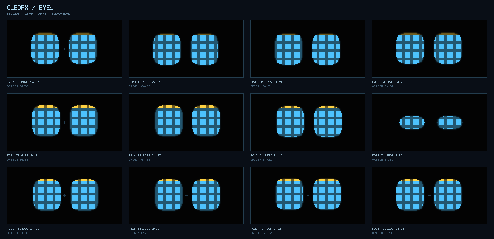
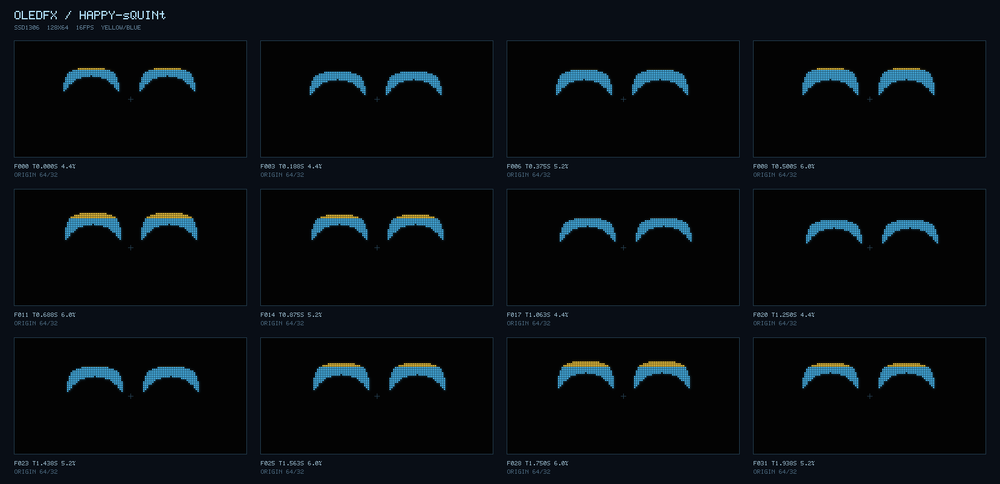

# oledfx

**微螢幕程序化動畫，把一點像素變成表情。**

為 SSD1306 128×64 等 1-bit OLED 製作動畫：用幾何畫出眼睛，在本機模擬器調整眼神，再以 **XOR-RLE → `.h`** 匯出給 MCU。純 ESM、零 runtime npm 依賴。



- **Curious eyes**：雙圓角眼睛、視線偏移與自動／手動眨眼。
- **Happy squint**：用下方黑色圓形切出彎月笑眼。
- **穩定網點**：threshold、17 階 Bayer 4×4、checker，使用固定空間網點。
- **OLED 預覽**：像素格、柔光、頂部 16 列黃光／下方藍光分區。
- **硬體匯出**：SSD1306 垂直 page 排列、PROGMEM 陣列、零 malloc C 解碼器。

Node.js 20+，下載後可直接執行，無須安裝套件：

```sh
npm test
npm run check
npm run gallery
```

開啟 `http://127.0.0.1:4173`，移動滑鼠或使用滑桿調整眼神。模擬器僅在本機提供服務。

```sh
node tools/render.mjs --fx eyes --dual-tone --out artifacts/eyes.png --still-out artifacts/eyes-still.png
node tools/render.mjs --fx happy-squint --dual-tone --out artifacts/happy-squint.png
node tools/export-mcu.mjs --fx eyes --frames 32 --fps 16 --out artifacts/eyes.h --symbol eyes
```

預設 2 秒、32 幀、16 fps：每組原始影格 32,768 bytes，範例匯出含索引表約 **3.0–3.3 KiB**。實際大小依動畫內容而變；`check` 會檢查決定性、孤立像素變動、大小預算與逐 byte 還原。



直接畫一幀：

```js
import { createFramebuffer } from './src/core/framebuffer.js';
import { create } from './src/fx/eyes.js';

const fb = createFramebuffer();
const eyes = create({ seed: 1, lookX: 0.5, lookY: -0.2, blink: 0 });
eyes.step(1 / 16);
eyes.draw(fb); // fb.data: 1024 bytes，直接對齊 SSD1306 pages
```

編寫動畫、JSON fixture 與 MCU 播放方式見 [AUTHORING](docs/AUTHORING.md)；產品規格保留於 [PRD 02](docs/PRD.md#prd-02oledfx)。
