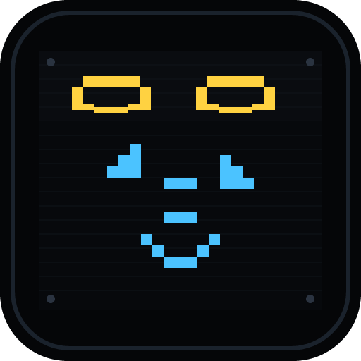
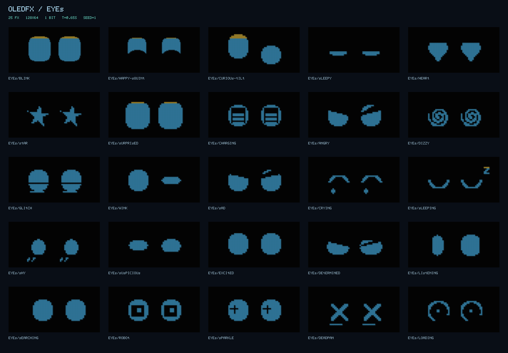

<p align="center"><a href="README.md">English</a> &nbsp;|&nbsp; <b>繁體中文</b></p>

<p align="center">
  
</p>

<h1 align="center">oledfx</h1>

<p align="center"><b>100 款程序化微型動畫，專為小型 OLED 與 RGB565 螢幕打造，執行時零依賴。</b></p>

<p align="center">
  
  
  
  
  
  
  
  <a href="https://malilion.github.io/oledfx/"></a>
  <a href="LICENSE"></a>
</p>

<p align="center"><a href="https://malilion.github.io/oledfx/gallery/"><b>線上展示 ↗</b></a></p>

**oledfx** 的每一格畫面都由輕量的程序化數學即時產生，不需要點陣圖素材。你可以先在瀏覽器預覽效果，再匯出成獨立的 C 標頭檔，用在 ESP32、RP2040、Arduino 等 MCU 上的 SSD1306 OLED、LED 點陣和 ST7789 TFT。

<p align="center">
  
</p>

## 特色

- **100 款效果**，分五類：機器人眼神、天氣、系統與 IoT、番茄鐘與桌面、轉場。
- **螢幕規格**：SSD1306 128×64／128×32（1-bit）、LED 點陣 64×32 與 ST7789 128×128（RGB565）。
- **抖動演算法**：閾值、4×4 Bayer、棋盤格、Atkinson。
- **XOR-RLE 壓縮**：2 秒循環動畫（32 格、16 fps）小於 4 KiB，直接解碼進驅動程式的 framebuffer，不用 `malloc`。
- **瀏覽器實驗室**：SSD1306 模擬器，即時顯示點亮率、XOR 差異與 Flash 大小，一鍵匯出 C 標頭檔和 Arduino 範例。

## 安裝

需要 Node.js 20 以上。沒有 npm 依賴，不需要執行 `npm install`。

```sh
git clone https://github.com/malilion/oledfx.git
cd oledfx
npm test
```

## 使用方式

```sh
npm run gallery                      # 開啟 http://127.0.0.1:4173/gallery/
npm run render -- eyes/blink         # 產生預覽
npm run export -- eyes/blink --format xor-rle --profile ssd1306-128x64 --symbol animation --out animation.h
npm run check                        # 品質檢查
npm run mcp                          # stdio MCP 伺服器
```

在 JavaScript 中使用：

```js
import { createFramebuffer, effects } from './src/index.js';

const screen = createFramebuffer('ssd1306-128x64');
const eyes = effects['eyes/blink'].create({ seed: 42 });

eyes.step(1 / 16);
eyes.draw(screen); // screen.data：1024 位元組，SSD1306 分頁排列
```

在 MCU 上（U8g2，搭配匯出的 `animation.h`）：

```cpp
if (oledfx_step_frame(display.getBufferPtr(), ANIMATION_FRAME_BYTES,
    animation_data, OLEDFX_READ_U32(animation_offsets + frameIndex),
    OLEDFX_READ_U32(animation_sizes + frameIndex), frameIndex)) {
  display.sendBuffer();
}
frameIndex = (frameIndex + 1) % ANIMATION_FRAME_COUNT;
```

U8g2 與 Adafruit SSD1306 的完整範例在 [firmware/examples](firmware/examples/README.md)。撰寫效果請看 [docs/AUTHORING.md](docs/AUTHORING.md)，燒錄 ESP32 請看 [docs/ESP32-BURN.md](docs/ESP32-BURN.md)。

## 效果清單

| 類別 | 數量 | 效果 ID |
| :--- | :---: | :--- |
| `eyes` 機器人眼神 | 25 | angry, blink, charging, crying, curious-tilt, deadpan, determined, dizzy, excited, glitch, happy-squint, heart, listening, loading, robot, sad, searching, shy, sleeping, sleepy, sparkle, star, surprised, suspicious, wink |
| `weather` 天氣 | 18 | aurora, cloudy, comet, drizzle, fog, frost, hail, moon, rain, rainbow, sandstorm, snow, starry, sun, sunrise, thunderstorm, tornado, wind |
| `system` 系統與 IoT | 22 | alert, battery, bell, bluetooth, cpu, download, fan, gps, heartbeat, humidity, lock, memory, mic, ota, sdcard, signal, speaker, sync, thermometer, unlock, usb, wifi |
| `pomodoro` 番茄鐘與桌面 | 20 | breathe, campfire, candle, checklist, coffee, desk-lamp, fireworks, flip-clock, focus-ring, hourglass, letter, nap, notebook, pencil, plant, stretch, tea, timer-beep, tomato, water |
| `transitions` 轉場 | 15 | bars, blinds, checker, circle-out, crt, diamond, dissolve, fade-center, iris, pixels, radar, scramble, slide-up, spiral, wipe |

## 授權

Copyright 2026 Malilion。採用 [Apache License 2.0](LICENSE) 授權，詳見 [NOTICE](NOTICE)。

---

<!-- malilion-ecosystem-footer -->
<p align="center"><sub>🦁 碼力獅 <a href="https://github.com/malilion">MaliLion</a> 生態系的一員 · <a href="https://malilion.com">malilion.com</a> · <a href="https://github.com/malilion?tab=repositories">更多作品</a></sub></p>
