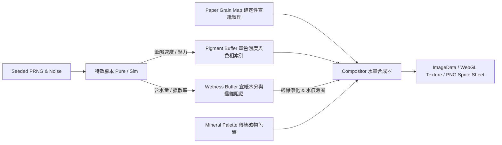
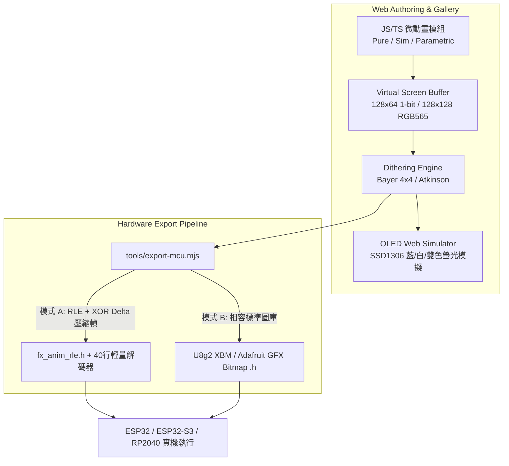
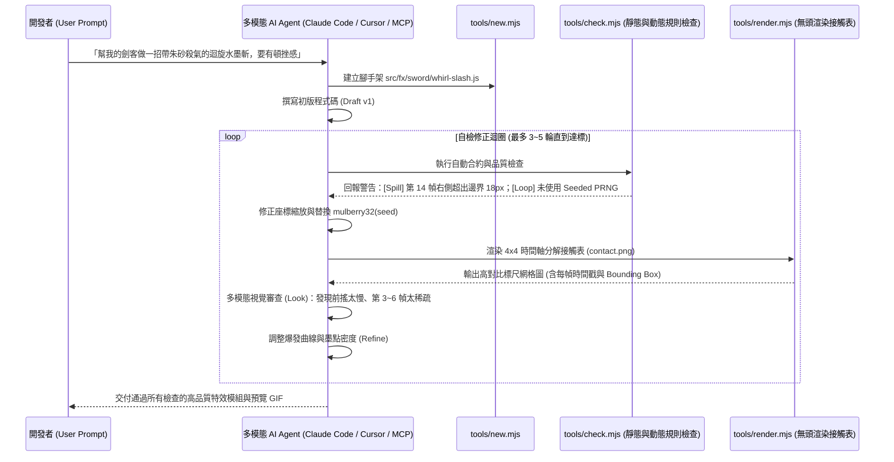

> Canonical Master PRD Suite (inkfx · oledfx · fx-skill-kit). This repo implements the section matching its name; Phase milestones below govern scope.

# 程序化資產與 AI Agent 閉環開源專案 — 深度產品需求文件集 (Master PRD Suite)


> **啟發基準專案**：`patch-gg/pixelfx`（Code-as-Asset ＋ Contact Sheet 視覺自檢 ＋ AI Agent Skill 閉環生成）
> **文件版本**：v1.0.0
> **文件定位**：可直接作為開源專案啟動藍圖、架構設計規格書與 AI Coding Agent（Claude Code / Cursor / Codex）上下文輸入之生產級 PRD。


---


## 目錄 (Table of Contents)


1. [全局架構哲學：為什麼這套範式能成為開源爆款？](#0-全局架構哲學為什麼這套範式能成為開源爆款)
2. [PRD 01：`inkfx` — 程序化東方水墨與武俠意境特效引擎](#prd-01inkfx--程序化東方水墨與武俠意境特效引擎)
   - 1.1 產品願景、痛點與差異化定位
   - 1.2 核心渲染架構：`Pigment + Wetness` 雙緩衝水墨物理模型
   - 1.3 API 契約、礦物色盤與武俠動作節奏系統 (`act`)
   - 1.4 概念驗證 (PoC) 參考實作：「水墨劍氣斬擊 (`sword-qi-slash.js`)」
   - 1.5 跨引擎匯出規格與展示牆 (Gallery) 需求
   - 1.6 非功能性指標 (NFR) 與發佈里程碑
3. [PRD 02：`oledfx` — 嵌入式微螢幕程序化動畫與硬體編譯庫](#prd-02oledfx--嵌入式微螢幕程序化動畫與硬體編譯庫)
   - 2.1 產品願景、痛點與創客圈破圈策略
   - 2.2 系統架構：1-bit / RGB565 核心與軟硬體雙端管線
   - 2.3 參數化微表情狀態機與 Dithering 抖動演算法規格
   - 2.4 硬體匯出器 (`export-mcu.mjs`)：RLE 差分壓縮與 ESP32 C Header 規範
   - 2.5 概念驗證 (PoC) 參考實作：機器人眨眼蓄力動畫 ＋ ESP32 解碼器
   - 2.6 非功能性指標 (NFR) 與發佈里程碑
4. [PRD 03：`fx-skill-kit` — AI Agent 自動渲染與視覺自檢閉環工具鏈](#prd-03fx-skill-kit--ai-agent-自動渲染與視覺自檢閉環工具鏈)
   - 3.1 產品願景：解決 AI 生成視覺程式碼「盲寫」的根本痛點
   - 3.2 閉環工作流架構 (Draft → Render → Look → Check → Refine)
   - 3.3 CLI 工具鏈詳細規格 (`new.mjs` / `render.mjs` / `check.mjs` / `act.mjs`)
   - 3.4 `check.mjs` 六大自動化品質守門員規則設計
   - 3.5 `SKILL.md` 提示詞架構與可插拔擴充介面（支援水墨、OLED 與全息閃卡）
   - 3.6 驗收標準與開源推廣策略


---


## 0. 全局架構哲學：為什麼這套範式能成為開源爆款？


傳統開源素材庫（圖包、Sprite Sheet、GIF）無法動態調參且體積龐大；傳統開源引擎（粒子系統、Shader 庫）則只有底層 API、缺乏開箱即用的精美成品。`pixelfx` 驗證了一個極具爆發力的黃金交叉點：


| 核心支柱 | 傳統做法痛點 | 新一代程序化開源專案標準設計 |
| :--- | :--- | :--- |
| **零依賴純代碼資產 (Code-as-Asset)** | PNG 序列圖動輒數十 MB，換色或改角度需重開繪圖軟體 | 每個特效僅 `1~3 KB` 純 JS/TS 模組，零外部圖片，支援 Seed 鎖定、動態換色與鏡像旋轉 |
| **確定性雙模式核心 (Pure & Sim)** | `Math.random()` 導致每次重播不同，無法無縫循環或除錯 | **Pure 模式** `draw(frame, t, opts)` 天然支援無縫 Loop；**Sim 模式** 固定 `120Hz` 步進與 Seeded PRNG，跨幀率表現完全一致 |
| **AI 視覺自檢閉環 (Visual Feedback Loop)** | LLM 寫 Canvas/Shader 只能靠猜，常出現破圖、出界或殘影 | 內建無頭渲染器輸出 **Contact Sheet（時間軸分解圖）** 搭配靜態/動態檢查器，讓多模態 Agent「親眼看見並修正瑕疵」 |
| **雙軌分發策略 (Runtime + Baker)** | 綁死單一框架（例如只能在 React 或只能在 Three.js 用） | 網頁端可直接 `import` 即時渲染（或直接 Copy-Paste 單檔）；非網頁環境透過 CLI 一鍵烘焙成 Sprite Sheet JSON 或 C Header |


---


# PRD 01：`inkfx` — 程序化東方水墨與武俠意境特效引擎


## 1.1 產品願景、痛點與差異化定位


### 背景與市場缺口
獨立遊戲、互動式視覺小說（Visual Novel）、國風／武俠網頁企劃與數位藝術專案中，開發者極度缺乏「水墨暈染、飛白劍氣、符咒燃燒、落櫻竹葉、毛筆刷拭轉場」等東方美學動態特效。現有程序化特效庫（包含 `pixelfx`、Sprite Fusion 等）95% 集中於歐美奇幻（火球、奧術光環）與科幻像素風，且普遍依賴「發光加法混合（Additive Glow）」，無法表現東方水墨**「濃淡乾濕、黑墨壓底、宣紙滲透與留白」**的獨特物理質感。


### 產品價值主張 (UVP)
打造全球首個**零圖片依賴、支援即時宣紙暈染模擬與武俠打擊節奏控制**的開源水墨程序化特效庫，內建百種東方意境特效與專屬 AI 水墨創作 Skill。


### 目標受眾 (Personas)
1. **網頁互動敘事／視覺小說開發者**：在 Canvas / Vue / React / PixiJS / Three.js 中需要極輕量（< 15KB gzipped）的劇情演出特效（如拔刀斬擊、心魔侵蝕、水墨轉場）。
2. **2D 獨立遊戲開發者 (Godot / Unity / Phaser)**：需要一鍵匯出可自訂礦物色盤的透明 PNG Sprite Sheet 與打擊幀時間軸資料。
3. **前端創意開發者 (Creative Coders)**：製作東方美學著陸頁、節慶互動賀卡、個人品牌網站背景動態。


---


## 1.2 核心渲染架構：`Pigment + Wetness` 雙緩衝水墨物理模型


`pixelfx` 使用 `color + light`（加法發光緩衝）表現高溫火焰；`inkfx` 則首創極輕量的 **`pigment（墨色沉積） + wetness（宣紙含水與滲透）` 雙緩衝像素網格模型**，在低解析度畫布（如 `320×180` 或 `256×256`）上以純 CPU `TypedArray` 達成即時水墨質感。





### 緩衝區資料結構設計 (`src/core/frame.ts`)
```typescript
export interface InkFrame {
  w: number;                // 畫布寬度 (建議 160~360px 保留筆觸顆粒與高效能)
  h: number;                // 畫布高度
  ox: number;               // 局部座標原點 X
  oy: number;               // 局部座標原點 Y
  pigment: Float32Array;    // 墨色濃度 [0.0 ~ 1.0]，0 為留白，1 為焦墨
  tint: Uint8Array;         // 色盤通道索引 (0: 主墨色, 1: 朱砂/點綴色, 2: 金粉/高光)
  wetness: Float32Array;    // 水分含量 [0.0 ~ 1.0]，決定邊緣擴散半徑與飛白閾值
  paperGrain: Float32Array; // 由 Seed 預生成的宣紙纖維高低圖 (Perlin/Value Noise)
}
```


### 三大核心水墨視覺演算法
1. **飛白演算法 (Dry-Brush / Feibai)**：
   當筆觸移動速率 $v$ 極快或筆毫殘餘水分 $w$ 偏低時，實際落墨條件需滿足 `pigment_input + wetness > paperGrain[idx] * dryFactor`。紙張紋理凹處不上墨，自然形成高速劍氣尾端斷續蒼勁的「飛白」絲縷感。
2. **水暈墨章 (Wet Diffusion & Dark Fringe)**：
   在 `Sim` 模式每步（120Hz）中，若 `wetness[idx] > threshold`，墨色向鄰近四格微幅擴散，並在濕潤交界處堆積微量墨粒（模擬宣紙乾涸時的深色水漬邊緣「水痕」）。
3. **傳統礦物色盤映射 (Mineral Color Ramp)**：
   摒棄 RGB 線性插值，採用 6 階非線性色階（**清、淡、重、濃、焦 ＋ 點綴色**）。預設提供：
   - `songyan`（松煙古墨：暖黑至宣紙米白 `#f4efe6`）
   - `zhusha`（朱砂血墨：焦黑、暗紅至丹朱 `#c83228`，適合殺氣、符咒、封印）
   - `shiqing`（石青竹翠：墨綠、花青至石青 `#2c6e7f`，適合風系、劍意、山水）
   - `nijin`（泥金佛光：玄黑底配鎏金點綴 `#d4af37`，適合破陣、金剛護體）


---


## 1.3 API 契約、礦物色盤與武俠動作節奏系統 (`act`)


### 預計收錄分類（首發目標 80~120 組特效）
- **`sword`（刀劍武學）**：一字拔刀斬、十字劍氣、萬劍歸宗、迴風落雁斬、刀罡碎地。
- **`talisman`（符籙陣法）**：八卦陣展開、符紙無火自燃、鎮魂印蓋落、墨鎖縛敵。
- **`zen`（自然意境）**：竹葉隨風、殘櫻飄落、寒梅綻放、孤舟水波、雲霧繚繞。
- **`ink- burst`（打擊與破招）**：墨點濺射、破防碎墨、重擊震波、氣血噴湧（水墨化處理不血腥但極具張力）。
- **`transitions`（轉場演出）**：大筆橫掃塗黑、墨滴入水暈開轉場、卷軸展開、火焰燒穿宣紙。
- **`ui`（國風介面）**：朱印蓋章（如「勝」、「破」、「極」）、銅錢散落、境界突破光暈。


### 武俠動作演出資料結構 (`act`)
武俠招式的靈魂在於**「靜如處子，動如脫兔」**——極長的凝氣蓄力、1~2 幀極速出劍、命中瞬間的畫面凝結（Hit-stop）與殘墨緩慢飄散：


```typescript
export interface WuxiaActSpec {
  windup: number; // 出招前蓄力秒數 (負值時間軸，如 -0.45s 壓低重心按劍)
  poses: Array<[time: number, poseId: string, easing?: 'snap' | 'linear' | 'easeOut']>;
  hits: Array<{
    t: number;        // 命中時間點 (秒)
    freeze: number;   // 頓幀秒數 (Hit-stop，武俠重擊建議 0.12s ~ 0.18s)
    shakeAmp: number; // 震屏像素幅度
    inkSplash: number;// 觸發受擊目標身上的墨點飛濺粒子數
  }>;
  recovery: number;   // 收劍歸鞘與殘墨消散秒數
}
```


---


## 1.4 概念驗證 (PoC) 參考實作：「水墨劍氣斬擊 (`sword-qi-slash.js`)」


以下為零依賴、可直接掛載於 HTML5 Canvas 驗證水墨飛白與墨點噴濺效果的核心參考結構：


```javascript
// src/fx/sword/sword-qi-slash.js
import { mulberry32, hash2d } from '../../core/seed.js';


export const meta = {
  id: 'sword/sword-qi-slash',
  duration: 0.75,
  loop: false,
  defaultPalette: ['#f4efe6', '#c9c2b8', '#7d766d', '#3b3734', '#161412', '#b82921'], // 末位為朱砂點綴
};


export const act = {
  windup: 0.4,
  poses: [
    [-0.40, 'SHEATH_CROUCH'],     // 壓身按劍
    [-0.08, 'EYE_GLINT', 'snap'], // 寒光一閃（朱砂色十字微光）
    [0.00,  'DRAW_CUT', 'snap'],  // 拔刀極速斬出
    [0.08,  'FOLLOW_HOLD'],       // 殘心定格
    [0.65,  'STAND_RECOVER'],     // 收刀立定
  ],
  hits: [{ t: 0.04, freeze: 0.15, shakeAmp: 3, inkSplash: 24 }],
};


export function create(opts = {}) {
  const rand = mulberry32(opts.seed ?? 1024);
  // 預生成飛濺墨滴粒子 (120Hz 物理步進)
  const droplets = Array.from({ length: 28 }, () => {
    const angle = -0.35 + (rand() - 0.5) * 0.65;
    const speed = 90 + rand() * 180;
    return {
      x: -30 + rand() * 20,
      y: 10 + (rand() - 0.5) * 12,
      vx: Math.cos(angle) * speed,
      vy: Math.sin(angle) * speed,
      r: 1.2 + rand() * 2.8,
      life: 0.25 + rand() * 0.45,
      age: 0,
      isCinnabar: rand() < 0.15, // 15% 機率帶一抹朱砂殺氣
    };
  });


  return {
    t: 0,
    step(dt) {
      this.t += dt;
      for (const d of droplets) {
        if (this.t < 0.02) continue;
        d.age += dt;
        d.x += d.vx * dt;
        d.y += d.vy * dt;
        d.vx *= 0.91; // 空氣阻尼急停，模擬甩墨頓感
        d.vy = d.vy * 0.91 + 18 * dt;
      }
    },
    draw(frame) {
      const progress = Math.min(1, this.t / 0.12); // 前 0.12s 完成斬擊弧線掃描
      const fade = Math.max(0, 1 - (this.t - 0.18) / 0.55);
      if (fade <= 0) return;


      // 1. 繪製主劍氣弧線（含飛白紋理）
      const steps = Math.floor(80 * progress);
      for (let i = 0; i <= steps; i++) {
        const u = i / 80; // 0 (起劍) -> 1 (劍尾)
        const arcX = -48 + u * 110;
        const arcY = 22 - Math.sin(u * Math.PI * 0.85) * 38;
        const thickness = Math.sin(u * Math.PI) * 7.5 * (0.4 + 0.6 * fade);
        const dryness = u * 0.75 + (1 - fade) * 0.35; // 劍尾與消散期飛白加劇


        stampDryBrush(frame, arcX, arcY, thickness, dryness, fade, u > 0.82 ? 1 : 0);
      }


      // 2. 繪製甩出的墨點與水暈
      for (const d of droplets) {
        if (d.age <= 0 || d.age >= d.life) continue;
        const k = 1 - d.age / d.life;
        stampInkDrop(frame, d.x, d.y, d.r * (0.7 + 0.3 * k), k * 0.95, d.isCinnabar ? 1 : 0);
      }
    },
  };
}


function stampDryBrush(frame, cx, cy, radius, dryness, intensity, tintIdx) {
  const rCeil = Math.ceil(radius);
  for (let dy = -rCeil; dy <= rCeil; dy++) {
    for (let dx = -rCeil; dx <= rCeil; dx++) {
      const dist = Math.hypot(dx, dy);
      if (dist > radius) continue;
      const px = Math.round(frame.ox + cx + dx);
      const py = Math.round(frame.oy + cy + dy);
      if (px < 0 || px >= frame.w || py < 0 || py >= frame.h) continue;


      const idx = py * frame.w + px;
      // 利用確定性座標雜訊模擬宣紙纖維與刷毛分岔 (絲縷飛白)
      const fiberNoise = hash2d(px, py * 2);
      const falloff = 1 - dist / (radius + 0.001);
      if (falloff - dryness * fiberNoise > 0.12) {
        const deposit = Math.min(1, falloff * intensity * 1.15);
        frame.pigment[idx] = Math.max(frame.pigment[idx], deposit);
        frame.wetness[idx] = Math.max(frame.wetness[idx], deposit * (1 - dryness));
        if (tintIdx > 0) frame.tint[idx] = tintIdx;
      }
    }
  }
}


function stampInkDrop(frame, cx, cy, radius, alpha, tintIdx) {
  stampDryBrush(frame, cx, cy, radius, 0.15, alpha, tintIdx);
}
```


---


## 1.5 跨引擎匯出規格與展示牆 (Gallery) 需求


1. **宣紙捲軸式互動展示牆 (`gallery/`)**：
   - 首頁以米黃宣紙質感背景同時流暢播放 80+ 個水墨縮圖（使用 `IntersectionObserver` 僅運算視窗內特效，維持 60fps）。
   - 頂部工具列支援：**一鍵切換礦物色盤**、**宣紙紋理粗細滑桿**、**開啟／關閉水墨武俠木人樁演出 (`act` toggle)**、**0.25x 慢動作逐幀檢視**。
   - 點擊任一特效卡片，右側彈出「Copy Single-File JS」、「Vue / React 元件範例」與「下載透明 PNG Sprite Sheet」。
2. **遊戲引擎匯出器 (`tools/export-sheet.mjs`)**：
   - 支援輸出透明背景（將墨色濃度轉為 Alpha 通道，保留邊緣水暈半透明感）或帶宣紙底色 PNG，並附帶相容 Aseprite / Godot / Phaser 的 JSON Atlas（內含 `meta.inkfx.act` 頓幀時間點）。


## 1.6 非功能性指標 (NFR) 與發佈里程碑


- **Bundle 體積**：`core` 引擎壓縮後 `< 4 KB` (gzipped)，單一特效檔案平均 `< 1.8 KB`。
- **效能預算**：`320×180` 畫布單一特效 `step + draw + composite` 在中階筆電單幀耗時 `< 1.2 ms`。
- **里程碑**：
  - **Phase 1 (Week 1–2)**：完成雙緩衝水墨核心、4 組礦物色盤、15 個刀劍與轉場核心特效。
  - **Phase 2 (Week 3)**：接入 Agent Skill 視覺自檢閉環，批次擴充並精修至 80 個特效。
  - **Phase 3 (Week 4)**：上線互動宣紙 Gallery 與 Sprite Sheet CLI，發佈 GitHub 與技術社群展示影片。


---


# PRD 02：`oledfx` — 嵌入式微螢幕程序化動畫與硬體編譯庫


## 2.1 產品願景、痛點與創客圈破圈策略


### 背景與開發者痛點
在 ESP32 / ESP32-S3、Arduino、RP2040 等微控制器開發桌面機器人（類似 Eilik / EMO / 桌面小電視）、智慧家居狀態屏或自製掌機時，最普及的顯示器是 `128×64` SSD1306 (1-bit 單色 OLED) 與小型 `128×128` / `240×240` TFT。
目前韌體開發者面臨三大痛點：
1. **靜態點陣圖塞爆 Flash**：把一段 30 幀的 GIF 轉成 C 語言 `PROGMEM` byte array 動輒數十至數百 KB，塞幾組表情就耗盡記憶體。
2. **表情死板無互動性**：預錄的點陣圖無法根據感測器（如溫度、音量、觸摸座標、電量）即時改變眼神看向的位置或粒子密度。
3. **上機燒錄迴圈極慢**：改一個像素或動畫曲線，要重新轉檔 → 編譯韌體 → 燒錄 ESP32 才能看效果，每次耗時 30~60 秒。


### 產品價值主張 (UVP)
**「在瀏覽器用 10 行 JS 即時預覽微螢幕動畫，一鍵編譯成超省記憶體的 ESP32 C/C++ Header。」** 結合真實 OLED 像素發光網頁模擬器、百種機器人微表情／UI 小動畫，以及專為 1-bit 小螢幕調校的 AI Agent 生成工具。


---


## 2.2 系統架構：1-bit / RGB565 核心與軟硬體雙端管線





### 支援硬體規格預設集 (Profiles)
| Profile ID | 解析度 | 色彩深度 | 常見硬體驅動 IC | 記憶體原始單幀大小 |
| :--- | :--- | :--- | :--- | :--- |
| `ssd1306-128x64` | `128 × 64` | 1-bit (單色/黃藍分區) | SSD1306 / SH1106 (I2C/SPI) | `1,024 Bytes` (1 KB) |
| `ssd1306-128x32` | `128 × 32` | 1-bit (單色) | SSD1306 窄條屏 | `512 Bytes` |
| `led-matrix-64x32`| `64 × 32` | RGB565 / 3-bit | HUB75 點陣屏 | `4,096 Bytes` |
| `st7789-128x128` | `128 × 128`| RGB565 (16-bit) | ST7789 / SSD1351 | `32,768 Bytes` |


---


## 2.3 參數化微表情狀態機與 Dithering 抖動演算法規格


### 核心動畫分類（首發目標 100 組微螢幕特效）
1. **`eyes`（桌面機器人靈魂眼神，25 組）**：自然眨眼、好奇歪頭、半瞇打瞌睡、愛心眼、驚嚇瞳孔地震、充電蓄力眼、生氣皺眉、暈眩螺旋、賽博故障閃爍（支援傳入 `lookX, lookY` 參數控制視線）。
2. **`weather`（桌面氣象站，15 組）**：像素傾盆大雨（帶底部水花）、晴天旋轉太陽、雷陣雨閃電反白、飄雪堆積、起霧。
3. **`system & iot`（硬體狀態回饋，25 組）**：Wi-Fi 搜尋漣漪、藍牙配對脈衝、OTA 更新進度條、電池快充氣泡、CPU 負載波形、溫濕度水滴。
4. **`pomodoro &desk`（桌面效率陪伴，20 組）**：沙漏翻轉、冒煙熱咖啡、篝火搖曳、數位翻頁鐘轉場、達成目標煙火。
5. **`transitions`（單色螢幕轉場，15 組）**：CRT 老電視關機縮成一線、百葉窗翻轉、隨機像素溶解、雷達掃描切換。


### 1-bit 灰階轉單色 Dithering 引擎 (`src/core/dither.ts`)
在 1-bit 單色螢幕上直接做 `luma > 0.5` 二值化會讓光暈與煙霧變成生硬的色塊。`oledfx` 內建有序抖動（Ordered Bayer Dithering），確保**相鄰幀不會因為誤差擴散而產生刺眼的隨機噪點閃爍（Temporal Shimmering）**：
- `threshold`: 純銳利幾何邊緣（適合機器人眼睛主體，確保邊緣乾淨不毛躁）。
- `bayer4x4`: 17 階穩定網點灰階（適合光暈、熱咖啡蒸汽、充電呼吸燈）。
- `checker`: 50% 棋盤格半透明遮罩（適合彈窗背景壓暗與黃藍雙色屏過渡）。


---


## 2.4 硬體匯出器 (`export-mcu.mjs`)：RLE 差分壓縮與 ESP32 C Header 規範


這是讓硬體開發者秒按 Star 的核心工具。執行一道指令即可把動畫編譯成極小體積的 `.h` 標頭檔：


```bash
node tools/export-mcu.mjs eyes/curious-blink \
  --profile ssd1306-128x64 \
  --fps 24 \
  --compress xor-rle \
  --out ./firmware/include/fx_curious_blink.h
```


### `XOR-Delta + RLE` 壓縮演算法設計
機器人眨眼或天氣動畫中，每幀之間往往只有 `5% ~ 15%` 的像素發生改變：
1. **Frame 0 (Keyframe)**：對垂直 Page 格式（SSD1306 原生記憶體佈局：每 Byte 代表垂直 8 顆像素）進行行程長度編碼（Run-Length Encoding）。
2. **Frame $N$ (Delta Frame)**：計算 `diff = frame[N] ^ frame[N-1]`。未改變的區塊全部變為 `0x00` 長串零值，經 RLE 壓縮後，**原本 30 幀需佔用 `30,720 Bytes` 的動畫，平均可壓縮至 `1.8 KB ~ 3.5 KB`（壓縮率達 88%+）**！


---


## 2.5 概念驗證 (PoC) 參考實作：機器人眨眼蓄力動畫 ＋ ESP32 解碼器


### Web 端動畫定義範例 (`src/fx/eyes/happy-squint.js`)
```javascript
// 參數化圓角矩形雙眼：支援即時視線偏移與笑眼彎曲度
export const meta = { id: 'eyes/happy-squint', duration: 2.0, loop: true };


export function draw(screen, t, opts = {}) {
  const lookX = (opts.lookX ?? 0) * 10; // -1.0 ~ 1.0
  const lookY = (opts.lookY ?? 0) * 6;


  // 眨眼與笑眼時間曲線
  let blink = 0;
  if (t > 0.15 && t < 0.35) {
    blink = Math.sin(((t - 0.15) / 0.20) * Math.PI); // 快速眨眼
  }
  const smileArc = t > 0.5 && t < 1.6
    ? Math.sin(Math.min(1, (t - 0.5) / 0.25) * (Math.PI / 2)) * (t > 1.35 ? (1.6 - t) / 0.25 : 1)
    : 0;


  const eyeW = 26, eyeH = Math.max(3, Math.round(28 * (1 - blink * 0.92)));
  const centers = [40 + lookX, 88 + lookX];
  const cy = Math.round(32 + lookY - smileArc * 4);


  for (const cx of centers) {
    // 繪製實心圓角白眼框 (像素值 1.0)
    screen.fillRoundRect(cx - eyeW / 2, cy - eyeH / 2, eyeW, eyeH, 6, 1.0);
    // 利用黑色圓弧從下方往上切出「月牙笑眼」效果 (像素值 0.0 挖空)
    if (smileArc > 0.05) {
      const cutOffset = Math.round(eyeH * (1.15 - smileArc * 0.55));
      screen.fillCircle(cx, cy + cutOffset, eyeW * 0.68, 0.0);
    }
  }
}
```


### 自動產出的 ESP32 C Header 與極簡解碼器 (`fx_happy_squint.h`)
```c
// Auto-generated by oledfx export-mcu.mjs | Profile: ssd1306-128x64 | FPS: 24 | Size: 2,140 bytes
#pragma once
#include <stdint.h>
#ifdef ARDUINO
  #include <pgmspace.h>
#else
  #define PROGMEM
  #define pgm_read_byte(addr) (*(const uint8_t *)(addr))
#endif


#define FX_HAPPY_SQUINT_W 128
#define FX_HAPPY_SQUINT_H 64
#define FX_HAPPY_SQUINT_FRAMES 48
#define FX_HAPPY_SQUINT_FPS 24


// 格式規範：最高位元 (0x80) = 1 代表重複 byte：[0x80 | count, value]；否則為原始連續區段 [count, b0, b1...]
static const uint8_t FX_HAPPY_SQUINT_DATA[] PROGMEM = {
  /* Frame 0 (Keyframe) */ 0xFF, 0x00, 0x8C, 0xFC, ...
  /* Frame 1..47 (XOR Delta) */ ...
};
static const uint16_t FX_HAPPY_SQUINT_OFFSETS[48] PROGMEM = { 0, 64, 72, ... };


// 零動態記憶體配置 (Zero-malloc) 解碼器：直接將 XOR 差分疊加至 SSD1306 1024-byte 緩衝區
static inline void oledfx_step_frame(uint8_t *fb_1024, uint16_t frame_idx) {
  uint16_t pos = pgm_read_word(&FX_HAPPY_SQUINT_OFFSETS[frame_idx]);
  uint16_t out = 0;
  if (frame_idx == 0) {
    for (uint16_t i = 0; i < 1024; i++) fb_1024[i] = 0;
  }
  while (out < 1024) {
    uint8_t header = pgm_read_byte(&FX_HAPPY_SQUINT_DATA[pos++]);
    if (header & 0x80) {
      uint8_t count = (header & 0x7F) + 1;
      uint8_t val = pgm_read_byte(&FX_HAPPY_SQUINT_DATA[pos++]);
      if (val == 0) { out += count; } // XOR 0 不改變原值，直接跳過超高速執行！
      else { while (count-- && out < 1024) fb_1024[out++] ^= val; }
    } else {
      uint8_t count = header + 1;
      while (count-- && out < 1024) fb_1024[out++] ^= pgm_read_byte(&FX_HAPPY_SQUINT_DATA[pos++]);
    }
  }
}
```


---


## 2.6 非功能性指標 (NFR) 與發佈里程碑


- **OLED 網頁模擬器擬真度**：必須支援「像素間微距黑縫（Pixel Pitch Grid）」、「外圍 Phosphor 微光暈染」、以及經典「上 16px 黃光＋下 48px 藍光」雙色 SSD1306 模擬切換（讓創客一眼認出硬體實機效果）。
- **MCU 記憶體預算**：單支 2 秒動畫壓縮後 Flash 佔用目標 `< 4 KB`，解碼器 RAM 額外開銷 `0 Bytes`（直接操作顯示驅動的既有 1KB Framebuffer）。
- **里程碑**：
  - **Phase 1 (Week 1–2)**：完成 1-bit 繪圖 API、Dithering 引擎、網頁端擬真 SSD1306 外殼預覽牆。
  - **Phase 2 (Week 3)**：完成 `export-mcu.mjs` XOR-RLE 壓縮器，並在 ESP32 / ESP32-S3 + 0.96 吋 OLED 實機驗證 `U8g2` 與 `Adafruit_SSD1306` 範例專案。
  - **Phase 3 (Week 4)**：錄製「左側瀏覽器即時調參、右側辦公桌 ESP32 實機同步眨眼」對比短影音發佈（極具社群傳播爆發力）。


---


# PRD 03：`fx-skill-kit` — AI Agent 自動渲染與視覺自檢閉環工具鏈


## 3.1 產品願景：解決 AI 生成視覺程式碼「盲寫」的根本痛點


### 為什麼大多數人用 AI 寫特效會失敗？
當開發者叫 LLM「幫我用 Canvas 寫一個帥氣的冰霜爆炸或水墨斬擊」，AI 第一次寫出來的程式碼往往：
1. **比例失衡或超出畫布邊界**（粒子飛出框外被硬生生切平）。
2. **動態節奏平庸（Floaty）**（全程等速運動，沒有爆發瞬間與緩衝收尾）。
3. **非確定性 Bug**（混用 `Math.random()` 導致每次重繪閃爍或 Loop 斷裂）。
4. **孤島像素與效能瓶頸**（在 1-bit 螢幕糊成一團白塊，或無效雙重迴圈拖垮幀率）。


`fx-skill-kit` 將 `pixelfx` 驗證成功的內部工作流提煉成一套**標準化、可插拔的 Agentic Harness（AI 視覺工程閉環套件）**，不僅能作為 `inkfx` 與 `oledfx` 的開發引擎，本身更可獨立開源為通用的「程序化視覺資產自檢框架」。


---


## 3.2 閉環工作流架構 (Draft → Render → Look → Check → Refine)





---


## 3.3 CLI 工具鏈詳細規格 (`new.mjs` / `render.mjs` / `check.mjs` / `act.mjs`)


為確保極速啟動與跨平台相容，CLI 採用 Node.js 20+ 原生 ESM 搭配輕量像素編碼器（如 `pngjs` 或 `@napi-rs/canvas`），單次渲染與檢查控制在 **`< 400 ms`** 內完成，不拖慢 Agent 思考節奏。


### 1. `tools/new.mjs <category>/<name> [--loop] [--sim]`
- **功能**：根據專案範本生成符合規範的特效起手式檔案，自動填入 `meta`、確定性 `seed` 初始化與型別註解，並更新 `src/catalog.json` 索引。


### 2. `tools/render.mjs <id> [options]`（Agent 的「眼睛」）
- **預設輸出 (`records/<id>/contact.png`)**：
  將特效完整生命週期均勻抽樣（例如 `4×4 = 16` 格關鍵幀；若有 `act` 蓄力，包含負時間軸幀），拼接成一張專為多模態大模型視覺辨識最佳化的 **Contact Sheet（視覺接觸表）**：
  - 每格繪製**淡色安全框（Safe Margin）與十字原點準星 `(ox, oy)`**，讓 AI 一眼看出重心有沒有偏掉。
  - 每格左上角印出像素字體標記：`#04 t=0.18s (fill:14%)`，幫助 AI 將「視覺看到的瑕疵」精準對應回程式碼裡的 `t` 時間區間！
- **擴充參數**：
  - `--sheet`：輸出遊戲引擎用透明 PNG Sprite Sheet + JSON。
  - `--gif`：輸出預覽動畫供 README 或 PR 展示。
  - `--multi-angle`（專為全息閃卡 `holofx` 類擴充設計）：輸出 `3×3` 九宮格不同傾角 `(tiltX, tiltY)` 受光測試圖。


### 3. `tools/act.mjs <id>`（連續動作除錯器）
- **痛點解決**：均勻抽樣 16 幀會漏掉瞬間發生的「1 幀閃爍」或「Hit-stop 卡頓異常」。`act.mjs` 以固定 `12 fps` 連續步進輸出完整動作分解條，專門讓 Agent 檢查蓄力（Wind-up）→ 命中定格（Freeze）→ 收招（Recovery）的肢體連貫性。


---


## 3.4 `check.mjs` 六大自動化品質守門員規則設計


AI 視覺感知強於美感與構圖，但弱於精確數值邊界。`check.mjs` 負責用程式化斷言攔截所有工程缺陷，輸出結構化 JSON 與人類易讀報表（Exit Code 非 0 時強制阻擋提交）：


| 規則代號 | 檢查名稱 | 檢測邏輯與演算法 | 預設閾值標準 |
| :--- | :--- | :--- | :--- |
| **`CHK-01`** | **確定性隨機檢查 (Determinism)** | 執行期 Monkey-patch 攔截全域 `Math.random` 與 `Date.now`；並以相同 `seed=42` 連續跑兩次完整動畫，比對第 `N` 幀 Buffer SHA-256 雜湊值 | 兩次雜湊必須 **100% 一致**；禁止任何未綁 Seed 之隨機呼叫 |
| **`CHK-02`** | **畫布邊界溢出檢查 (Edge Spill)** | 掃描每幀畫布最外圈 `1px` 邊框（上下左右四邊）的非透明像素總和（轉場類 `transitions/*` 豁免此規則） | 邊框觸碰像素比例 `< 1.5%`，防止特效像被剪刀齊頭切斷 |
| **`CHK-03`** | **循環無縫接軌檢查 (Loop Seam)** | 針對 `meta.loop === true` 之特效，計算 `t = 0` 與 `t = duration - 1/fps` 兩幀之像素均方誤差 (MSE) 與質心位移 | 首尾幀差異度需低於相鄰正常動態幀變化量之 `1.5x` |
| **`CHK-04`** | **空白尾幀與死區檢測 (Dead Frames)** | 檢測非蓄力階段的頭尾空白幀比例，以及是否有整段動畫填充率低於 `0.2%`（看不見）或高於 `85%`（全白過曝） | 尾端完全空白幀不得超過總時長 `15%` |
| **`CHK-05`** | **單幀效能預算守門 (Frame Budget)** | 在預熱 JIT 後，以 `120Hz` 連續執行 300 步並量測 `p95` 與 `max` 單幀耗時 | 單幀 `p95 < 1.5 ms`、`max < 3.0 ms`，杜絕 $O(N^2)$ 粒子迴圈 |
| **`CHK-06`** | **領域專屬檢驗器 (Domain Plugin)** | 透過外掛註冊：<ul><li>`oledfx`：檢查 1-bit 孤立單像素閃爍率（Shimmer Rate）與 RLE 壓縮後是否 `< 4KB`</li><li>`inkfx`：檢查濃淡墨階分佈熵值（避免退化成純單色黑塊，失去水墨層次）</li></ul> | 依各專案 `fx.config.js` 設定 |


---


## 3.5 `SKILL.md` 提示詞架構與可插拔擴充介面


為了讓其他開發者安裝你的開源庫後，也能在 Claude Code、Cursor 或自建 MCP Agent 中一鍵召喚「大師級特效師」，儲存庫內需包含精心設計的 `skills/<project-name>/SKILL.md`：


### `SKILL.md` 核心結構設計要點
```markdown
---
name: inkfx-author
description: 搜尋、整合、匯出或從零創作高品質程序化東方水墨特效 (inkfx)。當使用者要求製作武俠招式、水墨轉場、自然意境粒子或調整特效打擊感時觸發。
---


## 核心創作鐵律 (Artistic & Engineering Rules)
1. **絕對不要盲寫交差**：每次新增或修改 `src/fx/**/*.js` 後，**必須**依序執行：
   - `node tools/check.mjs <id>`（確保 0 Error、0 Edge Spill、確定性 Seed 通過）
   - `node tools/render.mjs <id>`（產出 `records/<id>/contact.png`，並使用讀圖工具親自檢視該圖片！）
2. **用挑剔美術總監的眼睛審查 `contact.png`**：
   - **節奏對比 (Contrast in Timing)**：爆發型特效必須在前 15% 時間內衝出主體輪廓，後 85% 緩慢擴散消散（切忌線性等速）。
   - **留白與飛白 (Negative Space)**：水墨切忌整坨死黑，中心焦墨外圍必須有乾筆絲縷或淡墨暈染；OLED 1-bit 動畫切忌大面積網點糊在一起。
   - **視覺重心**：檢查每格十字準星 `(ox, oy)` 是否對齊招式發起點或受擊中心。
3. **迭代修正**：讀圖後指出具體哪幾幀（例如 `#03 ~ #06`）表現最弱，修改程式碼後重新渲染比對，至少經過 2 輪視覺打磨再交付。
```


### MCP Server 進階封裝選項 (`tools/mcp-server.mjs`)
除了靜態 `SKILL.md`，還可提供一個不到 150 行的標準 **Model Context Protocol (MCP) Server**，直接暴露 4 個 Tool 給任何支援 MCP 的 AI 客戶端：
- `fx_search_catalog(query, category)`：語意搜尋現有特效與參數。
- `fx_render_contact_sheet(effect_id, palette)`：執行渲染並直接回傳 Base64 圖片區塊 (`image/png`) 給多模態模型。
- `fx_run_diagnostics(effect_id)`：回傳結構化 `CHK-01 ~ CHK-06` 診斷報告。
- `fx_export_asset(effect_id, target_format)`：一鍵匯出 Sprite Sheet 或 ESP32 C Header。


---


## 3.6 驗收標準與開源推廣策略


### 開源專案結構總覽（Monorepo 或單一精簡 Repo 模板）
```text
project-root/
├── .claude-plugin/          # 一鍵安裝 Agent Plugin 設定
├── skills/
│   └── <fx-name>/
│       ├── SKILL.md         # 核心閉環提示詞與美術規範
│       └── references/      # 繪圖原語速查表與優秀範例剖析
├── src/
│   ├── core/                # < 500 行零依賴核心引擎 (frame, prng, compositor)
│   ├── fx/                  # 分類特效庫 (每個特效獨立單檔，支援直接複製使用)
│   └── index.js             # 對外 Runtime API 入口
├── tools/
│   ├── new.mjs              # 腳手架生成
│   ├── render.mjs           # Contact Sheet / GIF / Sprite Sheet 渲染器
│   ├── check.mjs            # 六大品質守門員測試
│   ├── export-mcu.mjs       # (oledfx 專屬) 硬體 C Header 編譯器
│   └── mcp-server.mjs       # 選配 MCP 視覺閉環服務
├── gallery/                 # Vite 打造的零延遲互動預覽牆 (GitHub Pages 自動部署)
└── docs/
    └── AUTHORING.md         # 人類與 AI 共讀的特效開發合約
```


### 開源冷啟動與破圈檢查清單 (Launch Playbook)
1. **README 首屏決勝（前 3 秒定生死）**：頂部放一張 60fps 錄製的 `6×4` 特效同時播放網格動圖（水墨宣紙牆或 OLED 螢光機器人眼神牆），第一句話寫明數量、零依賴與內建 Agent Skill。
2. **雙棲技術內容輸出**：
   - 一篇主打**成品視覺與即插即用**（吸引前端、遊戲與創客下載使用）。
   - 一篇深度拆解 **「我如何用 `render.mjs + check.mjs` 給 AI 裝上眼睛，自動迭代出 100 個高品質特效」**（精準切中 AI Agent 開發者社群痛點，極易引發轉發與複刻）。
3. **極致低摩擦體驗**：提供 GitHub Pages 線上 Gallery，讓路過的人不用 `npm install` 就能在網頁上換色盤、拖曳視線參數、一鍵複製單檔程式碼或下載 `.h` / `.png` 檔案。